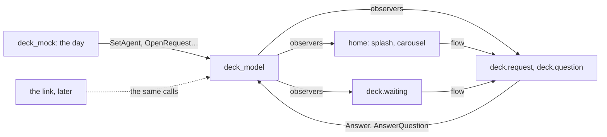

# Agent Jam Sticky — Agent Deck

How the agent deck's screens are built on the Sticky. It covers the model and the mock day, the startup screen and the carousel that own home, the needs-you list, the request and the question, the closed-request page, the settings and the Wi-Fi page. It covers standby and the off frame, the focus walk, and what is left to the link. People read it before they change a deck screen or port the link. Coding agents read it before they touch `components/agent_deck`. Source of truth: `components/agent_deck/`, the code. Related: [APP_ARCHITECTURE §7](APP_ARCHITECTURE.md#7-screens-routes-and-focus) for the home seam and the router, [DESIGN.md](../DESIGN.md) for every value and rule, [STICKY_DESIGN_TOKENS §13](STICKY_DESIGN_TOKENS.md#13-claudes-mascot-page) and [§14](STICKY_DESIGN_TOKENS.md#14-the-agent-deck-ports-additions) for the mascot and the kit's deck additions.

**Stability.** Code comments cite this doc's `§n`. Do not renumber; add new material under the next free number. `AGENT_DECK n` in a comment is the agent deck's own doc, section n, in its repo (`claude-agent-deck-3`, read only). The Sticky's screens are drawn from its elements, words and order.

| § | Section | Look here for |
| --- | --- | --- |
| 1 | [The shape](#1-the-shape) | The parts and which owns what |
| 2 | [Rules](#2-rules) | What the screens keep |
| 3 | [The model and the mock day](#3-the-model-and-the-mock-day) | The records, the observers, the day the mock plays |
| 4 | [The screens](#4-the-screens) | The startup screen, the carousel, the list, the request, the question, the closed page, the settings, the Wi-Fi page, standby, the off frame, the stepped lines |
| 5 | [Leaving, routes and the bench](#5-leaving-routes-and-the-bench) | Where each screen leaves to, the routes, how to reach each by the console's `key` word |
| 6 | [The mascot and its sounds](#6-the-mascot-and-its-sounds) | The move each state plays, how it is heard |
| 7 | [Decisions](#7-decisions) | Why the walk, the stop and the closed page are shaped so |
| 8 | [Traps](#8-traps) | Symptoms and their causes |
| 9 | [Open items](#9-open-items) | What the person or the next stage settles |

---

## 1. The shape

**The deck is one feature, `components/agent_deck`, that claims home and registers six routes; every screen reads one model, and the mock day writes it until the link does.**

| File | Holds |
| --- | --- |
| `agent_deck.cpp` | `Install()`: claims home (`app_hooks::ClaimHome`), registers the routes in a `kBoardUp` step |
| `deck_model.h`, `.cpp` | The records, the queue, the observers, the settings, the battery, the Wi-Fi record and its asks, the standby page's state |
| `deck_rules.h` | The rules with no LVGL: the words, the page order, the count, the moves, where a request leaves to, the battery's words, the zones, the standby page's words, the list avatars' pick |
| `deck_mock.h`, `.cpp` | The deck's made-up day as C structs, played on one `lv_timer`; the battery's readings; the radio and the Mac that answer the Wi-Fi page and Connect |
| `deck_flow.h`, `.cpp` | The routes' ids, which request opens from where, where it leaves to |
| `settings_screen.cpp`, `wifi_screen.cpp` | The settings; the Wi-Fi page in each of its stages |
| `home_screen.cpp` | The startup screen, then the carousel: the overview and a page per agent, or the standby page in their place |
| `waiting_screen.cpp`, `answer_screens.cpp`, `closed_page.cpp` | The needs-you list and its avatars' idle cycle; the request and the question; the closed-request page |
| `off_frame.h`, `.cpp` | The frame the glass keeps while the deck is off (§4.10) |
| `deck_stage.cpp`, `deck_clock.cpp`, `deck_ui.h` | A page's mascot and its voice; the clock; the shared places and containers, and `Step`, the stepped line (§4.11) |
| `logo.c`, `make_logo.py`, `agent_jam_logo.png` | The startup logo at one bit, its regeneration script and its art |

The mascot's voice (`components/mascot_voice`) is shared with the hardware test's mascot page, and the way the board leaves (`components/power_leave`, §4.10) with the hardware test's Sleep and Power off buttons, so neither feature includes the other's header (APP_ARCHITECTURE §2, E4). The home seam is `app_hooks::ClaimHome` (APP_ARCHITECTURE §7).

---

## 2. Rules

- **Every control is the kit's** — a screen builds layout with plain objects and every button, chip, row, card, bar, dot and icon from `components/widgets` (DESIGN → The kit). A screen that needs a control the kit lacks adds it to the kit first; the deck's own additions are the small chip, the link indicator, the stacked status block, words one size down, the swipe page (§4.2).
- **Every value is a token** — a position is a sum of tokens in `deck_ui.h` (`kMascotY`, `kFootTop`, `kDotsTop`, `kAnswersTop`, `kReviewTop`), never a literal.
- **A one-line field too long for its room steps, and ends in dots only once it has made its passes** — `Step` in `deck_ui.h`, or the list row's and the network row's opt-in. Each has a key so a page built again keeps a pass under way (§4.11; DESIGN → Exceptions → Stepped lines on the deck's screens).
- **The mascot is drawn in front of every element of its page** and passes over them; nothing moves out of its way (DESIGN → Exceptions → Claude's mascot on the deck's screens).
- **A covered or left screen stops** — its timers, its subscription and its mascot's loop stop in `OnExit`, and run again in `OnEnter` (DESIGN → Motion → Waits and things that update on their own).
- **Nothing updates faster than `motion.self-update`** — the state chip counts its time on every 5 s; the clock follows the minute.
- **A screen opens with no ring**, except where a control appears — the overview's count, Review — which rings as it appears (§4.2).
- **Holding OK is Dismiss** on the request, the question and the list; the carousel holds nothing (DESIGN → Focus and input).
- **A swipe up or down begun anywhere on a paged screen turns it** — the Wi-Fi page's lists, the settings, the request's text, the question's cards and the needs-you list (one page, so `sound.at-end` answers), from the heading, the empty room or a control, which the swipe does not press (`widgets::ClaimPageSwipe`; DESIGN → Layout → Paging; the person, 2026-11-26).
- **A request ends on the agent that asked** (AGENT_DECK 4.7; §5).
- **Made-up names only** — the mock day's agents and hosts are the deck's own examples.

---

## 3. The model and the mock day

### 3.1 Records and the queue

**The model keeps the deck's records — agents, usage, queued requests and questions, the link — in the shape the link will call.** `SetAgent`, `RemoveAgent`, `SetUsage`, `OpenRequest`, `OpenQuestion`, `CloseRequest` and `SetLink` are AGENT_DECK 6's calls; `Reset` forgets everything and closes what is queued as timed out. Agents stand in arrival order, twelve at most; a thirteenth takes the oldest idle agent's place, else the oldest done one's, else is refused. The queue holds four. A fifth `OpenRequest` returns false and is left to the terminal. A screen's answer leaves the queue and goes to the listener the link sets (`SetListeners`). The agents', the queue's and the Wi-Fi record's tables live in PSRAM (`lvgl_display::InPsram`, APP_ARCHITECTURE §2), as do home's and the mock's state: only the LVGL task touches them. `Answer(id, allow)` answers a request. `AnswerQuestion(id, part, chosen)` answers a question, with `chosen` 0 leaving it to the terminal.

### 3.2 Observers

**A screen subscribes in `OnEnter`, unsubscribes in `OnExit` and reads the model again when a change comes or when it enters.** The `Subscribe` call takes a function and a user pointer. `kMaxObservers` is five: only the screen on top listens, since a screen pushed over another takes it out through `OnExit`, so the top screen, one leaving, and the buzzer following the sound setting leave room. A change says its event and the id, and for an agent whether it is new and the state it had. A page covered by a request misses nothing, since it rebuilds from the model as it comes back.

### 3.3 The mock day

**The mock plays AGENT_DECK 18's day — 180 s, looping — as C structs calling the model, on one 100 ms `lv_timer`.** It starts as the startup screen hands over, so the overview says `Connecting...` for a moment and then the day's first step brings the link up. Each step is a record at its time into the day. A step marked `kOpen` is sent only while its request still waits (the timeout or the terminal's answer the bridge would report). A request's id is made unique per loop, so one day never answers another's. An answer from a screen is heard a tick later, as the deck's mock hears it. The agent then goes back to work: on the same tool when allowed, thinking when denied. The battery reads `Charging • 62%` at the start, 73 % at 80 s and `Charged • 84%` from 110 s, off the charger. The day ends on standby. At 158 s the bridge puts the deck on standby, and the next 22 s are the standby page. Connect is answered with the snapshot 3 s on, which begins the day again. Left alone, the loop's own snapshot at 180 s ends it. The Wi-Fi page is answered by the mock's radio and Mac (§4.8). `tests/host/deck_model_lvgl_test.cpp` plays the day on a fake clock, step by step, loop after loop.

---

## 4. The screens

### 4.1 The startup screen

**The mascot says hello in the home view's place — `MascotMove::kHello`, the wave's first hand once, no flapping, the deck's entrance — and under it, centred, the Agent Jam logo, `Designed for Creators` and `ALXV Labs`; once the hello has played, home hands over.** The hello and its hold begin when the screen's first frame — a full refresh, about 1.6 s on a V1.0 — is on the glass (`LV_EVENT_REFR_READY`), so the whole hello reaches the glass. The hold is `motion.startup-hold`, 2 s, never less than the hello's `widgets::kMascotHelloMs`, 1.8 s (the person, 2026-11-26: it waves before it goes home, a simple wave without the flapping). The logo is `agent_jam_logo.png` at twice its size, 310 × 70, one bit. `make_logo.py` regenerates `logo.c`, standard library only. The hold pauses while another screen covers home and resumes with what is left. The hand-over builds the carousel in place of the startup screen and asks a full refresh, so the logo leaves no ghost.

### 4.2 The carousel

**One mascot stands in the place the home view gives it; the overview and a page per agent are built from the model around it.** The page is one `widgets::MakeSwipePage` (a sideways swipe turns one page, decided on the lift; at either end nothing wraps and `sound.at-end` sounds). The clock is top-right. The chip's bottom stands `spacing.md` under the jump's headroom and `spacing.lg` lower than the first mock; a name above it stands `spacing.sm` over it, centred, in `title`. A name, a doing line or an `in <session>` line too long for its room steps along its words instead of ending in dots (§4.11).

| Page | Says |
| --- | --- |
| Overview | The count chip (`1 needs you`, `2 working`, `3 done`, `Connecting...`); `Usage 42%` in `title` over the lead bar, `Weekly 17%` in `caption` over the other, each reset line right-aligned under its bar in quiet words |
| A session | The name over the state chip (`Working for 4m`); under the mascot `Context 63%` in `title` over the lead bar where the overview's Usage window stands, so the bar never shifts between pages; its tokens right-aligned under it in quiet words; then the doing line, `spacing.sm` on, where the overview's Weekly starts |
| A sub-agent | The task over the chip; the doing line, `in <session>`, then its type and its tokens side by side, `spacing.sm` apart |
| A Needs you page | Review, the kit's action button, centred in its one place, its ring `spacing.md` over the page dots, only while a request of the agent's is queued |

**The state's time counts on every 5 s** (`motion.self-update`) — seconds under a minute, then minutes, hours and days. The person's "counted in minutes, no faster than the self-update" reads as that: a page never counts faster than 5 s, and past a minute counts in minutes.

**The walk turns the pages.** The focus group holds, in order, a guard, the page's one stop, a guard, then the foot's four icons. UP and DOWN walk it:

- DOWN from the page's stop reaches the guard after it; the guard turns to the next page and gives the focus straight back to the stop, so one press is one page. On the last page the same step goes on to the foot's Wi-Fi icon, then the sound toggle, then Settings, then Power.
- DOWN from Power wraps to the overview; UP from the overview reaches Power; UP from Wi-Fi comes back to the last page. Every walk wraps (DESIGN → Layout → Paging).
- **The page's stop** stands over its control when the page has one — the overview's count while a request waits, Review — so the ring is the control's, and OK on the stop presses it, the first press only showing the ring. Else it is an unseen stop over the page's facts that draws no ring (its `LV_STATE_FOCUS_KEY` outline transparent). OK there presses nothing, and the page dots say where the person is. It is marked `router::SetFirstPressActs`, so the first UP or DOWN turns the page at once (DESIGN → Layout → Paging; the person, 2026-11-26). The control itself is out of the group, so the walk's order is the page's own, and a tap on it works as on any button.
- **A control rings as it appears** — a page turned to, a request arriving, home entered or uncovered: one press of OK opens what waits. A touch takes the ring off, as everywhere.

**The foot** is the bridge link, an indicator on the left edge with no box, no hit area and no place in the group. The Wi-Fi, sound, settings and power icon buttons stand flush right, `spacing.sm` apart, Power last at the right edge. The page dots stand centred `spacing.md` over it, hidden while only the overview shows. The sound toggle is the same tonal tile on and off, its glyph alone the state — the speaker with waves or with a slash (the person, 2026-11-26: "it shouldn't change color"). It flips `model::SoundOn` — the setting the settings' Sound row shares — and the whole buzzer follows it. Off, `devices::SetMuted` silences every sound: the press tick, the ten words and the mascot's voice. Only the hardware test's raw buzzer check (`devices::Tone`) still sounds. Wi-Fi and Settings push `deck.wifi` and `deck.settings` (§4.7, §4.8). **Power** is the same tonal icon button as they are, named `Turn off`, a stop in the foot's walk, and turns the deck off at once with no confirmation (§4.10).

**Events the mascot answers**, where the person is looking. A skip answers an agent that joins (the overview, never the first). A celebrate answers a session finishing (the overview). A dust jump answers a sub-agent finishing (its session's page). A spin answers the 5-hour share crossing 50 % (the overview) and a request being allowed (the asking agent's page, as home comes back).

### 4.3 The needs-you list

**`Needs you` in `title` heads the list, `4 sessions` tight under it in `caption-regular` in quiet words, and Dismiss stands centred at the answers' place.** The rows are the kit's list rows on cards (the light dither, `layout::CardFace`), four a page. Each holds the agent's mascot at 6 px a cell and its name in `body`, 30 px regular. Under the name, what it asks and how long it has waited are in `caption-regular`, 26 px regular. The agent with the oldest request is first. A row opens that agent's oldest request over the list. **A name or facts line too long for its room steps** (§4.11). The two lines of a row move together, and rest at their start after their passes, ending in dots, a row being a control. The count line is 26 px regular under the heading's 30 px semibold, a step in size and in weight, on `caption`'s 32 px line. The list follows the queue: a request closed in the terminal takes its agent off, and one arriving joins. The ring stays on the same agent's row while it waits, else on the row that took its place or the one before. With nothing left it goes on to home. Dismiss and holding OK leave for the overview. **The avatars play the deck's idle cycle** (AGENT_DECK 4.7; DESIGN → Exceptions → Claude's mascot on the deck's screens): at rest, and every `rules::kAvatarIdleEveryMs`, 3 s, one avatar is picked at random, never the one before while there is another (`rules::PickAvatar`, a hash of the clock). It plays one cycle and comes home. The cycle is the idle's lean (`widgets::kMascotIdleCycleMs`, 5 s) or the look-around (`kMascotLookCycleMs`, 5.6 s) at even odds from the pick's hash, neither walking nor skipping out of the avatar's place. **The avatars stand on a layer of their own over the whole page**, made after the rows and Dismiss and placed over each row's slot, `spacing.md` in and centred on the row. A lean or a look carries an avatar past its row, and no row, ring or button clips it or draws over it: the mascot is in front of everything on the page (the person, 2026-11-26). The list never pages, four rows for four requests at most, so the slots never move. The screen looks every 100 ms. A cycle is longer than the 3 s between picks, so two may move at once. One alone on the list is not picked again until it is home, so its cycles stand 6 s apart. The cycle runs through the list's 5 s rebuilds (the rows keep it by agent). It stops when a request covers the list or the list is left, and begins again from 3 s when the list is entered. The avatars are heard as the home view's mascot is, through one `mascot_voice::Voice`: the moments, never the music. A blink two of them share is heard once (`kSameBlinkMs`, 110 ms). **What it costs:** every frame of a cycle is a partial refresh, about 2 a second, counting toward the twenty. A lean changes the glass 6 to 8 frames and a look-around 9 to 11 on the host's render, in a box of about 68 × 52 px. With picks every 3 s and cycles of 5 s or more, the list is never at rest while it is up. Two avatars at once make the window the box round both. By arithmetic, with rows 96 px apart, it is 148 px tall for neighbours and about 340 for the first and the last of four.

### 4.4 The request

**The tool in `title` (stepping along itself when too long, §4.11), the agent in quiet words and its place in the queue (`1 of 3`, solid black) on one line `spacing.md` apart. The body stands in the kit's text view between them and the answers, its scroll indicator in the glass's right margin. Deny and Allow stand in two halves at the answers' place.** There is no Dismiss button: holding OK leaves the request waiting. It opens with no ring on Deny, so the first press rings it. A body the bridge cut ends in `... Read the full text in the terminal`. An answer leaves the queue, sends the decision and leaves (§5).

### 4.5 The question

**The header in `title`, the agent and count as the request's, and the question in `caption`. The question stands `spacing.lg` over its first answer, a step above the answers' own `spacing.md` (the person, 2026-11-26; DESIGN → Layout → Spacing). The answers are the kit's choice cards — a ring for one, a box for several — whose names come down to `caption-strong` over their details in `caption-regular`, bold over regular at one size. Each name and its detail stand `pair-sm` apart: the regular comes up 2 px to close its leading of 10 (STICKY_DESIGN_TOKENS §14). Dismiss and Send stand in two halves, Send never disabled.** A pick is not the answer: it leaves the page where it is. Send sends a bit for each card chosen. Pressed with nothing picked, it sends nothing: `sound.error` says so and the ring goes to the first answer, its page turned into view (DESIGN → Components → States → Disabled: explain rather than disable; the person, 2026-11-26). Dismiss and holding OK send 0, leaving it to the terminal, which asks it too.

When the question and its cards run past the room they turn by page together, whole items a page. The band is cut to the page's first and last items, so the next page's first item never shows in what is left. A card turns its page as it takes the focus, and a swipe up or down turns one. The kit's scroll indicator stands in the right margin.

### 4.6 The closed-request page

**The mascot in the home view's place and under it the stacked status block — `Answered` / `in the terminal`, `Timed out` / `before an answer came`; no control, no clock.** It appears in place of the request on view, as one change of the glass, when the request closes elsewhere; the route `deck.closed` shows it alone. The spin begins so that it ends on the rest pose as the page leaves, `motion.answered-hold`, 2.3 s, after it appears. The look-around from its start is asked to rest so the eyes are home as it leaves at `motion.timed-out-hold`, 1.8 s (DESIGN → Exceptions → Timed leaves). A press and a hold do nothing meanwhile. It leaves where §5 says. A close in the terminal sets no allow, so no second spin follows.

### 4.7 The settings

**`Settings` in `title` at the heading's place, the clock top-right, no status bar; under it the kit's controls in one column `spacing.md` apart, every control's words in `caption`, the Sound label's size. The title, the words that take no ring and every card stand on the content's edge, x 24; Back stands at the answers' place.** The foot's Settings icon opens it (`deck.settings`); it opens with no ring on Sound.

| Row | Control | Says |
| --- | --- | --- |
| Sound | The kit's toggle row | `On` or `Off` — the setting the foot's sound button shares (`model::SoundOn`) |
| Auto sleep | A `caption` name over the kit's range slider | 5 to 60 min in steps of five, 30 at first |
| Wi-Fi | The kit's toggle row | `On` or `Off`; off, the radio leaves its network and the link is told |
| The network | The kit's network row as a card (`NetworkLook::kCard`): the light dither with no edge, `Connected`, the lock and the signal, every word black — never black-filled | OK opens the Wi-Fi page. Joining, the same card says `Connecting…`; not joined, it is a value row on a card, `Network` / `Not joined`; with the switch off, `Network` / `Wi-Fi off`, disabled and never hidden. These, the Wi-Fi page's `Wi-Fi off` and the battery's `On battery` and `Low battery` words are the deck's own, approved by the ux-content-writer for the person (2026-11-26) |
| Time zone | The kit's dropdown on a card | Opens the kit's select sheet of the fifteen zones (`rules::kTimeZones`); there is no Time zone page |
| Battery | The kit's value row as a reading, out of the walk, its words on the content's edges | `Charged • 84%`, `Charging • 62%` while it charges; from the deck's own words `On battery •` under 80 % and `Low battery •` under 20 % |
| Hardware test | The kit's list row on a card, its words `caption` | Opens `hw.home`; only when that feature is built in |

**The title's edge:** the title, Sound's, Wi-Fi's and Auto sleep's names and Battery stand on the content's edge, x 24, and Battery's value on the right one, 456: their rings go round the toggle or the slider, or they take none. The rows whose ring goes round them whole — the network, Time zone and Hardware test — are cards on the light dither (`layout::CardFace`), their box on the edge and their words `spacing.md` inside, so a ring always stands in the margin round a box (DESIGN → Layout → Spacing; STICKY_DESIGN_TOKENS §14.9). The scroll indicator's lane stays clear of both pages. The walk is Sound, Auto sleep, Wi-Fi, the network, Time zone, Hardware test, Back; holding OK goes back. **The rows page**, whole rows a page, as the kit's lists: with Hardware test they run past Back's ring, so page 1 is the six from Sound to Battery and page 2 runs from Wi-Fi to Hardware test. A band a ring's reach round the rows shows one page and clips the rest, so every row stays in the walk (the group skips hidden objects); the walk turns the page — Hardware test focused shows page 2, Sound or the slider page 1 — and the kit's scroll indicator stands in the rows' right margin. Back is the outline button `spacing.button-back` wide. The page is built again when the network row's words change (the Wi-Fi page's answer, the switch), the walk and the page keeping their place; a sheet or dialog open holds that off until it closes. The Hardware test row opens `hw.home` in the settings' place (`router::GoToRoute`), so the stack is home, `hw.home`, Display and one of Display's own pages: four, the router's depth. Back from the hardware test's home goes to the deck's home (the person, 2026-11-26).

### 4.8 The Wi-Fi page

**`Wi-Fi` in `title` and one of six stages, drawn from the model's Wi-Fi record; every button asks the link (`model::AskWifi`) and the page changes when the link's answer is written (`SetWifi`).** The foot's Wi-Fi icon and the settings' network row open it (`deck.wifi`). A change of stage builds the page again, and the control the stage offers rings as it appears.

| Stage | Content | Buttons |
| --- | --- | --- |
| Joined | The network row (a control, a card on the light dither as the settings' is: OK opens the kit's destructive dialog `Forget Studio?` on Cancel; its name in `caption-strong` over `Connected` in `caption-regular`), its facts as the kit's detail rows five a page on one card, the page's stop, on the network card's edges, each label in `caption-strong` over its value in `caption`, the scroll indicator in the right margin | Back \| Disconnect in two halves; no Forget button |
| Not connected | The stacked status — the Wi-Fi mark over `Not connected` and its line — centred across the glass and on its height | Back \| Connect (action) |
| Wi-Fi off | The same, `Wi-Fi off`, `Turn Wi-Fi on in Settings to connect.` | Back; Connect disabled |
| Networks | `Networks` and `Pick the Mac's network` in quiet words, the Mac's networks strongest first, four a page, each a card at rest, the one being joined the chosen inversion | Cancel \| Scan |
| Joining | `Step 2 of 3`, `Joining <network>` (stepping when the name is long, §4.11), the step bar (one done, one running), centred on the glass's height | Cancel, centred |
| Wrong password | The stacked status and the step bar with the second step failed | Cancel \| Retry |
| Paired | The check, `Bridge paired`, the three steps done | Done, centred |

Holding OK is the stage's Cancel or Done where it has one, else back. The step bar does not creep: nothing on the page animates. **The mock's radio and Mac** answer a tick after each ask. Connect and Scan bring four networks. A pick joins for 3 s and pairs. The first join of `Studio-Upstairs-Guest-5G` is refused (wrong password) and its Retry pairs. Done joins the picked network with the facts of the day. Cancel, Disconnect and Forget leave it. The deck starts joined to Studio.

### 4.9 Standby

**When the bridge says another deck is the active one, home shows the standby page in place of the overview and the agents' pages.** The state stands in the chip where every page's chip stands, the mascot idles in its column, the line is centred under it in black, Connect stands where Review stands, and the foot has no page dots. It is home's own state (AGENT_DECK 4.13), not a route, so the foot's icons — Power too — and the settings work from it. The model's `SetStandby(true)` forgets the agents and the usage. It closes a request on view with no closed page and no cue (the screens above home leave for it). Only `Reset`, the snapshot's reset, takes the deck off standby.

| State | Chip | Line | Connect |
| --- | --- | --- | --- |
| Standby | `On standby` | `Another deck is active.` | Outline, ringed as it appears |
| Connecting | `Connecting` | `Asking your Mac to make this deck active.` | Disabled, no ring |
| Timed out | `On standby` | `Your Mac did not answer. Try again.` | Live, ringed again |
| Refused | `On standby` | `Another deck is on the cable.` | Live |

Connect asks the link and the page says it is connecting; `kConnectWaitMs`, 15 s (AGENT_DECK 4.13) with no snapshot, and it is timed out; a `standby` that comes while it waits is the refusal. The mascot plays `kIdleInPlace` — the leans and the look-around, never a walk or a skip across Connect — and is silent.

### 4.10 Power and the off frame

**Power turns the deck off at once, with no confirmation (the person, 2026-11-26).** The foot's last icon, `Turn off`, asks `power_leave::LeaveSoon(kPowerOff, BuildOffFrame)`. The frame the glass keeps is the standby layout with the chip `Off`, the mascot at rest, and `Hold OK to turn on.` in `caption`, black, centred under it, with no clock, no buttons and no foot. It is the same icon button as Wi-Fi and Settings (DESIGN → Exceptions → The icon button). It is `IconAction::kPower` with BYTE-90's `power.png`, 34 px of ink on the 40 px glyph box, through `marks/make_marks.py`. It stands on home's foot, and on standby's too. `components/power_leave` is the sequence the hardware test's Sleep, Power off and Off, 60 s buttons run as well, each passing the frame it leaves on (APP_ARCHITECTURE §1). It silences the buzzer, clears the RTC wake, replaces the screens above home with the frame, draws it in full, puts the panel to sleep, then calls `board::PowerOff`, with deep sleep when the rail does not fall (STICKY_HARDWARE_SPECS §5.3). It runs from a 50 ms timer, not inside the click that asked, so the press has finished. A second press meanwhile is the same leave. `off_frame.cpp` draws the frame from the home view's own places: the chip's row (`layout::StateChip`), the mascot's place and the facts' place. It is built as the person's draft showed it. The person has not yet seen it on the glass.

### 4.11 Stepped lines

**A one-line field too long for its room rests, then steps along its words, and after its passes stands at its start ending in LVGL's dots (the person, 2026-11-26: the deck's marquee, stepped for e-paper; DESIGN → Exceptions → Stepped lines on the deck's screens).** The widget is `widgets::MakeMarquee` (STICKY_DESIGN_TOKENS §14.6). A screen builds a line with `layout::Step(parent, role, text, key, align)` and a row with an opt-in. The table lists each field.

| Field | Where | How |
| --- | --- | --- |
| An agent's name over the chip | An agent's page | `Step`, centred, the content wide; a name that fits stands centred |
| The doing line, `in <session>` | An agent's page; the sub-agent's leads its facts | `Step`, `caption`, the facts column wide |
| The tool | The request's heading | `Step`, `title` |
| `Joining <network>` | The Wi-Fi page, joining | `Step`, `title` |
| A row's name and facts | The needs-you list | `MakeListRow(…, ListRowFit::kSteppedCounting, key, Type::kCaptionRegular)`: the name `body`, the facts `caption-regular` and counting the wait |
| A network's name | The joined row on the Wi-Fi page, the Mac's networks, the settings' network row | `MakeNetworkRow(…, NetworkName::kStepped, key)`, in `caption-strong` |

Body text, which wraps, and every other line keep what they had: the state chip, a button's label, a value row's value and the hardware test's rows keep their words or their dots.

**The rhythm** (the draft the person approved, A): a line rests `motion.marquee-rest`, 4 s, with its start in view. Then it moves `spacing.marquee-step`, 48 px, every `motion.marquee-step`, 1 s, round three passes, its words coming round after a gap of three spaces. The last step lands on the start and the line stands there, its words once, cut where its room ends with three full stops (the person, 2026-11-26: "Stopped readings end in …"). **Every line stands at its start after its passes** (the person, 2026-11-26: "Stop after 3 passes"; WCAG 2.2.2, DESIGN → Accessibility). Standing, it draws the dotted label's pixels and makes no frame. Begun again, it holds its words twice and steps. **A line in a control** — a list row, a network row — begins again when it is set again with other words, focused or pressed. **A reading** — the page's own lines — begins again, resting first, when its words change or its page is turned to or shown again: a carousel page turned to, a screen entered or uncovered, a page built again with new words. The same words set again do nothing: a pass under way goes on, a line standing stays standing. **A line that fits stands still**, centred in place.

**A page built again keeps a pass under way.** Home builds its page again on every record, and the list every `motion.self-update`. Each line carries a key (`MarqueeKey(scope, owner, field)`). The scope is `kScopeHome`, `kScopeList`, `kScopeRequest`, `kScopeWifi` or `kScopeSettings`, the owner is an agent's, request's or network's place, and the field is the line's own. So a line made again with the same words takes the old one's pass over. A record that changes another agent leaves this page's passes where they are, or its lines standing; a new doing line starts from its start. The list's facts line counts the wait, so its words change every rebuild: it is made to carry its pass on through new words. A covered screen's lines (an overlay, a pushed screen) stand still and rest again when it is uncovered, a reading that had stopped beginning again as its page is shown again (STICKY_DESIGN_TOKENS §14.7).

**What it costs.** A step is one partial refresh and counts toward the twenty (STICKY_DESIGN_TOKENS §5). While a long line moves that is about one a second. A pass is the words and the gap in steps of 48 px. So a 62-character doing line in `caption` (744 px, a pass of 780 px) moves for 17 steps a pass, 51 s for three, and then stands. A 39-character name in `title` moves for about 48 s, then stands. Every line on the screen steps on one clock, so a name and a doing line, a row's two lines and four rows all step in the same frame and cost one refresh a second, not one each. The step is a change of state on LVGL's timer and the glass draws it with the next frame. So while the mascot is playing — on the carousel's pages, the startup and standby screens, the closed page and the list's avatars, about two frames a second — a step rides a frame already due. Where nothing else changes that second the step is a refresh of its own. A long reading on a page at rest is one a second for its three passes, a full refresh about every 20 s of moving, and then nothing. A line that has made its passes stands at its start in dots and draws nothing until its page is turned to or shown again or its words change. A session page's 62-character doing line is 51 s of steps, about 51 partial refreshes, then 0 a second. So a page left alone costs about 51 partials a visit, then none from its lines. That the step rides a mascot frame is by construction and not measured on the glass. Neither is how the panel's standby after 1 s idle (`kStandbyAfterMs`, `components/lvgl_display/display.cpp`) sits between steps 1 s apart (§9).

---

## 5. Leaving, routes and the bench

### 5.1 Where a request leaves to

**A request or question ends on the agent that asked** (AGENT_DECK 4.7). `rules::LeaveFor(opened_from_list, others)` decides, `others` being the requests still waiting besides the one that ended — for Dismiss, one fewer than the queue holds, since the dismissed one waits too.

| | Leaves to |
| --- | --- |
| No other waiting | Home, on the asking agent's page; a request allowed there plays the spin |
| Others waiting, opened from home | The needs-you list, in place of the request |
| Others waiting, opened from the list | Back to the list; with none left, home on the agent's page |

Home reads what is left for it (`flow::TakeReturn`) as it comes back, so an agent's page the person never asked for is never shown.

### 5.2 Routes

**The deck adds six routes, each opening one screen.** A route takes the param the last column names.

| Route | Screen | Param |
| --- | --- | --- |
| `deck.waiting` | The needs-you list | none |
| `deck.request` | A permission request | the id, or `<id>/list` from the list |
| `deck.question` | A question | the same |
| `deck.closed` | The closed-request page | `answered` or `timed-out` |
| `deck.settings` | The settings | none |
| `deck.wifi` | The Wi-Fi page | none |

A param that names no request or question waiting is refused, and the glass does not change. The stack is home, then at most three screens (`router::kMaxDepth`, four): the list, a request opened from it, nothing over that; or `hw.home` in the settings' place, then a test screen and one of its own pages.

### 5.3 Reaching each screen with the console's `key` word

The deck's home is the root; the hardware test is `hw.home`, which the console's `hw` word opens over it. A fresh screen's first `key` only shows the ring (APP_ARCHITECTURE §7), and the day's times are the mock's (§3.3).

| To reach | Do |
| --- | --- |
| The startup screen | Boot; it stays for its first frame and the hello's 2 s, about 3.6 s on a V1.0 |
| The overview | Wait 2 s past boot |
| An agent's page | `key down`, once per page; at most one more first if no ring shows |
| A Needs you page and Review | DOWN to it; Review is ringed as it appears: `key ok` opens its request |
| A request | At 18.1 s into the day the overview's count is ringed: `key ok` |
| The needs-you list | At 114.6 s four agents ask: the count says `4 need you`; `key ok` |
| A question | At 32.1 s agent-deck-studio asks; with web-shop's request also waiting, the count opens the list; its row opens the question |
| A closed page | Leave a request open: at 48 s it times out; at 103 s request 3 is answered in the terminal |
| The foot | DOWN past the last page: Wi-Fi, sound, Settings, Power |
| The settings | The foot's Settings icon: DOWN past the last page to it, `key ok` twice (the first only rings) |
| The Wi-Fi page | The foot's Wi-Fi icon, or the settings' network row. Joined at first; Disconnect, then Connect, then a network, then (3 s) Done or Retry walk every stage |
| Standby | At 158 s into the day, with 22 s to press Connect (3 s to the snapshot) before the loop's own ends it |
| The off frame | The foot's Power icon, `key ok` twice (the first only rings): the board leaves on it. On the host, `power_leave` is stubbed and the frame is built by the screens test |
| Stepped lines | From 3 s into the day, agent-deck-studio's page (`key down` once): its doing line is a full file path, then at 11 s a longer one, at 58 s a build command. From 110 s, `docs-site-api-reference-migration`'s page: its name over the chip and its doing line both step; from 114.6 s its row in the needs-you list does too |
| The hardware test | `hw`, or the settings' Hardware test row (in the settings' place), then `key down` and `key ok` as before; `bench`, `anim` and `pages` open its screens from any place |

---

## 6. The mascot and its sounds

**A page's mascot plays its state's move, looping, in front of everything; the overview's stands for every agent.** The overview jumps while anyone needs you, else types while anyone works, else idles. A page plays by state. Working types. Needs you hops or waves in turns. Done finishes or celebrates by a coin the page keeps (a turn the plan's limit ended idles). Idle and a previous chat idle in the faded greys (`rules::OverviewMove`, `rules::AgentMove`). A page turned to starts its move from its start; a record on the page asks for the next move and the one playing finishes first; a reaction plays once between.

**On standby it idles in its column, silent** (`kIdleInPlace`: no walk and no skip across Connect, and none of its moments is told to the buzzer).

**Heard by its moments and its music, outside the ten words** (DESIGN → Motion → Sound): `mascot_voice::Voice` tells each moment to `devices::QueueMoment` as its frame is drawn. It keeps the music (the typing, the spin, the success, the wave, the thinking) in time with the move, as the hardware test's mascot page does. The sound toggle turns the voice off. **The needs-you list's avatars are heard the same way**, by their moments and no music, through one voice for the list (§4.3).

**The deck's news has four sounds of its own, heard wherever the glass is** (DESIGN → Motion → Sound). A request or question joining the queue sounds `sound.attention`. The link coming up sounds `sound.link-up`. A usage record naming a limit sounds `sound.usage-limit`. An agent starting work, new or back from idle or done, sounds `sound.agent-start`. `agent_deck.cpp` hears every change through one model observer, installed at `kBoardUp`, and `rules::EventSoundFor` picks the sound. The link and the limit sound as they come, never again for a record that repeats them, and a question's later parts, which share its id, are silent. A request closed and sent again, as a snapshot after a Reset does, sounds again. On standby none sounds, as the mascot is silent there. The deck still keeps what it heard, so the link and the limit are current when standby ends. `rules::EventSoundCuts` keeps a lower one from cutting a higher one still sounding, in that rank, attention highest, so a snapshot's agents starting do not drown the link coming up. While one sounds, `devices` drops the mascot's moments (`sound::Leads`). The sound toggle mutes them with the rest. They are the deck's own cues moved into the buzzer's band, chosen by the person from the draft (2026-11-26).

---

## 7. Decisions

**Each decision below is held for the reason beside it, with the alternatives that do not work.**

| Decision | Why | Alternatives that don't work, and why |
| --- | --- | --- |
| The mascot and the needs-you list's avatars loop while their screen is up and rest when the device sleeps | The person's decision, 2026-11-26: "it will rest during when the device sleeps"; the glass is judged on the V2.0 at its sign-off for the sheet and the swipe, and on a V1.0 ("V1 is fine glass looks fine"). The cost stands: the list's avatars make about 6 to 11 frames a cycle, a cycle begun every 3 s, so a full refresh about every 11 s on the V1.0 while the list is up (§4.3) | A rest after a time takes the mascot's life off a screen the person is looking at; a rest only at sleep needs no timer of its own |
| A stepped line rests `motion.marquee-rest`, 4 s, before its first step | The person's decision, 2026-11-26: "let's do 4s", as the token and the approved draft's text say | 5 s, as the draft's GIF held, makes the first step a beat late against its words |
| The question's Send is never disabled; pressed with no pick it sounds `sound.error` and rings the first answer | The person's decision, 2026-11-26: DESIGN → Components → States → Disabled asks a reason in words, and the footer has no room for one under Send | A disabled Send with no reason breaks that rule; a reason line under Send runs off the glass; a reworded question line is not the deck's |
| The settings' Hardware test row opens `hw.home` in the settings' place | The person's decision, 2026-11-26: with the settings under it, Display's own pages were a fifth screen, which `router::kMaxDepth` refuses | A depth of five holds a fifth screen's objects in internal RAM, already tight with the kit page; Display's pages in Display's place skip it on Back |
| The deck's four event sounds rank attention, usage limit, link up, agent start, and a lower one is dropped while a higher one sounds | The buzzer has one voice, and a snapshot brings the link up and its agents working in one moment | Each cutting the last plays only the final boop of a snapshot; queueing them plays news late |
| The title, bare words and every card stand on the content's edge; a row whose ring goes round it whole is a card | The person's decision, 2026-11-26: "title and cards should all align at the edges. left and right padding would allow for focus ring"; the question screen is the reference | Words at 40 with no box sit off the title's edge; bare words at 24 under a whole-row ring put the ring 8 px from them |
| The home is claimed through `app_hooks::ClaimHome`, four plain functions | The deck has no status bar, so the shell's home cannot be added to; `app_hooks` carries no router type (E2) | A `router::Screen` in `app_hooks` breaks E2; a flag in the shell naming the deck breaks E1 |
| The page's stop is a proxy standing over the control, with guards to turn the page | UP and DOWN must turn pages and still reach the foot and keep the router's ring rule (the first press rings, moves nothing); the group skips nothing but hidden objects | Editing mode on the stop (`LV_KEY_UP` and `LV_KEY_DOWN` to a handler) loses the router's first-press ring and breaks holding OK; one stop per page puts a control out of the walk's order |
| The page dots are made again with every page | A pill's width follows its state, and a state changed before the dots' first frame is not laid out | Flipping `SetPageDot` in place shows the old pill until a later layout |
| The closed page takes the request screen's place in one change | One refresh instead of three (pop, push, pop) | Pushing `deck.closed` over the request holds both in internal RAM and leaves through the stack twice |
| The startup screen and the carousel share one root | Home is the stack's bottom and never popped | A second root cannot replace the first; pushing the carousel over the splash draws home once for nothing |
| Standby is home's own state, not a route | The deck's page is built in place of the carousel (AGENT_DECK 4.13); the foot and the settings stay reachable and the stack keeps its depth | A pushed route holds home and standby together and leaves through the stack |
| The settings' rows page in a clipping band, Hardware test on page 2 | The six rows end 64 px over Back's ring and a row needs 80; the approved frame's numbers stay, and a clipped row stays in the walk where a hidden one would not | A seventh row on one page pushes Back off the glass or squeezes the rings under 16 px; hiding the other page's rows takes them out of the walk |
| The Wi-Fi page asks the link and waits for its answer | The link will answer in time; the mock answers a tick later, never from inside the click that asked, which would delete the button it came from | A page that moves its own stage shows what the link has not done |
| A list stands on a column as wide as the glass | The kit's scroll indicator stands in the right margin, past a content-wide column, which clips it | A list in the content column hides the indicator |
| Power turns the deck off with no confirmation | The person's decision, 2026-11-26 (DESIGN → Exceptions → The icon button): the press is the intent, and the frame says what happened and how to turn it on | A dialog before the off adds a step the person declined |
| The way the board leaves is a component of its own, `power_leave`, with the frame passed in | The hardware test and the deck both leave the board and a feature may not include another (E4); the sequence carries the buzzer's, the RTC's and the panel's safety order once | Each feature keeping its own copy lets the two drift apart; the deck including `hw_test`'s header breaks E4 |
| The list's avatars play the deck's cycle at the deck's numbers | The person's decision, 2026-11-26, "you are missing the animations idle animations on the mascots in the agent list": the cycle is the deck's, unchanged | A still avatar leaves the list a row of statues, as the deck's developer put it; fewer or slower picks change the deck's numbers |
| A long line steps on one clock, and a key carries a pass across a page built again | The person's decision, 2026-11-26 (DESIGN → Exceptions → Stepped lines on the deck's screens): the deck's marquee, stepped for the glass; home and the list build their pages again on every record and every 5 s, and a line made new each time would never get past its first step | A clock per line costs a refresh each and drifts; a line made again that starts from its start never moves on; a longer step or a smooth scroll is the draft's other letter and a motion the glass cannot show |
| Names, headings and figures sit on `title`'s own 36 px line box | The role is the kit's call and a gap is measured between its own boxes | A hand-set 40 px box is a size no token names |

---

## 8. Traps

**Each trap is a symptom, its cause and its fix; the first group shows on the screens, the second in the host tests.**

### 8.1 On the screens

- **The page dots show the old pill after a turn** → a state flipped in place before the dots' first frame → the dots are made again with every page (§4.2).
- **A closed page crashes the next tick** → the request screen's clock label went with the page it replaced → `ShowClosed` resets the clock and stops the tick.
- **A control rings and then does not** → `router::Focus` after `router::Ring` on the same stop takes the ring off when no button has been read → the walk focuses first, then the page turns and rings.
- **The first group member takes the focus as it is added** → a guard heard it before the stop existed → the guards listen only once the stop has the focus.
- **The Wi-Fi page's scroll indicator does not show** → the list stands in a column the content's width, which clips the lane that stands in the margin → the lists stand in a host as wide as the glass (`ListHost`).
- **A button deleted by its own click** → a page rebuilt from inside the click's handler → Connect, and every Wi-Fi ask, answer on the next pass (the mock's tick, `lv_async_call`).
- **The startup screen goes home mid-wave, the wave hardly seen on the glass** → its hold and the wave's clock began before its first frame. That frame is a full refresh that holds the glass about 1.6 s on a V1.0 → the hello and the hold begin at that frame's `LV_EVENT_REFR_READY`, and the hold outlasts the hello (§4.1). A move a screen must show whole starts when the screen is on the glass.
- **A stepped line stands still and does not move again** → it has made its three passes, and nothing has started it since → it begins again when its page is turned to or shown again, its words change, or, in a control, it is focused or pressed (§4.11).
- **A long line never gets past its first step** → each rebuild of the page makes a new line → give it a key, and `carry` where its words count a time (§4.11).
- **A stepped line's first letter is a column thin** → a stem stands 1 px left of its cell, past the clip → the window reaches 1 px left (STICKY_DESIGN_TOKENS §14.6).
- **The startup screen flaps both hands for 5.4 s where the draft waved one** → the build took "the mascot waves" as `kWave`, the move by that name. The approved draft's code plays `kHello` → a screen's mascot plays the move its approved draft's code calls, read from the draft, never chosen from a description of it.

### 8.2 In the host tests

- **The host test crashes after the settings, one screen on** → a layout forced on the settings page in `OnCreate`, before the screen is loaded → nothing forces a layout there.
- **The standby mascot is a fragment at the glass's right edge in the host render** → the idle in place is pixel-style frames, which the host renderer does not draw → the frame on the glass is the person's to judge.
- **A mascot in the startup screen shows only its legs in the host render** → the wave and the work are the pixel style's frames, which the host renderer does not draw (the draft's note says the same); the move on the glass is the person's to judge.
- **The host test segfaults in a closed page's destructor, only with `DECK_DUMP`** → a screen's LVGL objects are deleted before the router frees the screen object. The stage's `lv_obj_is_valid(root)` read the freed mascot → the stage keeps its root through `router::Hold`, which LVGL clears on delete, and checks that. `lv_obj_is_valid` is no guard for a pointer that may already be freed.
- **The deck screens test draws no startup frame, then segfaults, after a helper is added** → the helper sat outside the test file's anonymous namespace. The firmware's sources are linked into the test, and a helper with outside linkage sharing a name with one of theirs is one function to the linker (the likely cause, not proven) → every helper of a host test stays in its anonymous namespace.
---

## 9. Open items

**Each item below is open until the person or the glass settles it, as its last column names.**

| Item | Status | Unblocked by |
| --- | --- | --- |
| The off frame (§4.10), built as drafted: the chip, the mascot at rest, `Hold OK to turn on.` | Open | The person's look on the glass |
| The link: records arrive from the Mac over UART0 or Wi-Fi; the model's calls are the link's | Open | The logic port |
| The settings keep Auto sleep, the time zone and the Wi-Fi switch in the model only: the glass does not sleep by it and the clock does not follow the zone | Open | The logic port |
| The battery is the mock's; the board's gauge is not read here | Open | The logic port |
| The Wi-Fi page draws only the wrong-password failure; the deck's other failures, the Mac asked and the bridge pairing steps come with the link | Open | The logic port |
| The panel goes to standby after 1 s without a refresh (`kStandbyAfterMs`), and a stepped line's steps are 1 s apart, so each step may wake it; and a long line's steps, one partial a second for its three passes, bring the full refresh about every 20 s of moving (§4.11) | Open | The person, on the glass, with the battery and the ghost the loop leaves |
| The 15 s Connect wait and the mock's 3 s answers are the model's and the mock's timings, not DESIGN motion tokens | Open | The person |
